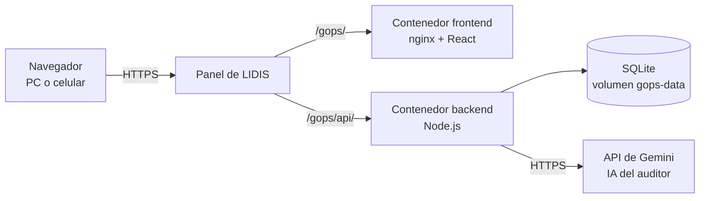

# Arquitectura de GOPS

GOPS usa una **arquitectura cliente-servidor en tres capas**, empaquetada en dos contenedores Docker.

## Capas

| Capa | Tecnología | Responsabilidad |
| --- | --- | --- |
| Presentación | React (SPA) servida por nginx | Pantallas, cálculos de tarifas y seguridad social, reglas del auditor, borradores de correo |
| Lógica | Node.js 22 sin dependencias externas | Sesión, guardado de datos, respaldos y traducción de las consultas de IA |
| Datos | SQLite (`node:sqlite`) en un volumen de Docker | Persistencia de los datos y copias diarias |

## Flujo de un dato (por ejemplo, registrar una OPS)

1. La pantalla llama a `window.storage.set(...)`, una interfaz interna de la app.
2. La capa de acceso (`frontend/src/entry.jsx`) la convierte en `PUT api/storage/ops-app-state-v1` con el token de sesión.
3. El backend valida el token y ejecuta una consulta preparada (`INSERT … ON CONFLICT DO UPDATE`) sobre SQLite.
4. Antes de escribir, guarda en `respaldos` la copia del valor anterior (una por día, 30 días).

## Decisiones de diseño

| Decisión | Motivo |
| --- | --- |
| Backend sin librerías externas | Menos puntos de fallo, imagen pequeña y nada que actualizar por seguridad |
| SQLite en un volumen | Un solo archivo, sin servidor de base de datos que administrar; los datos sobreviven a reconstruir los contenedores |
| Datos como documento JSON por clave | Rápido de construir y de migrar desde la versión anterior (datos en el navegador); es el punto a evolucionar si el proyecto crece |
| Token firmado (JWT) sin estado en el servidor | El backend se puede reiniciar sin cerrar sesiones |
| Patrón adaptador para la IA | Cambiar de Gemini a Claude u OpenAI es solo una variable de entorno |
| Auditor híbrido: reglas + IA | Las reglas deciden y calculan (resultado predecible); la IA solo explica y ordena. Nunca modifica datos |
| Reintentos y modelo de respaldo para la IA | Google puede saturar un modelo; el servidor reintenta y, al final, usa `IA_MODEL_ALT` |
| Fusión por versión (`_v`) | Si se edita desde dos dispositivos, se conserva la versión más reciente de cada registro |
| Variables de entorno (`.env`) | Las claves quedan fuera del código y del repositorio |
| Docker Compose | Un solo comando levanta y actualiza todo |

## Seguridad

- Contraseña cifrada con scrypt y sal; comparación en tiempo constante.
- Token HMAC-SHA256 con vencimiento de 12 horas.
- Bloqueo de 5 minutos tras 5 intentos fallidos de ingreso.
- Consultas SQL con parámetros (sin concatenar texto del usuario).
- La IA solo recibe los hallazgos del auditor, no documentos ni correos.

- ## Decisiones de arquitectura (ADR)
- [ADR-001: JavaScript como stack único](adr/ADR-001-stack.md)
- [ADR-002: SQLite en un volumen de Docker](adr/ADR-002-base-de-datos.md)
