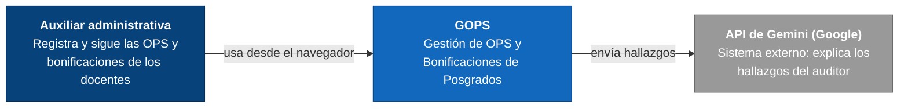
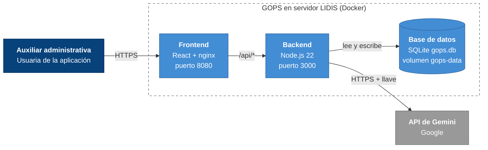

# Arquitectura de GOPS

GOPS | Gestión de OPS y Bonificaciones de Posgrados (USB Cali).
Arquitectura cliente-servidor de tres capas, cada una en su contenedor Docker.
La usa la Auxiliar administrativa de posgrados.

## Nivel 1: Contexto

## Nivel 2: Contenedores

## Notas
- La clave de la IA vive solo en el servidor, nunca en el navegador.
- Los datos persisten en el volumen Docker `gops-data`, con respaldo diario y 30 días de retención.
- Los niveles 3 y 4 de C4 (componentes y código) no se documentan: el código ya los muestra.
