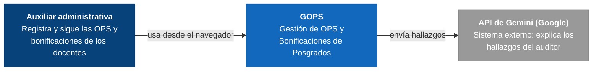
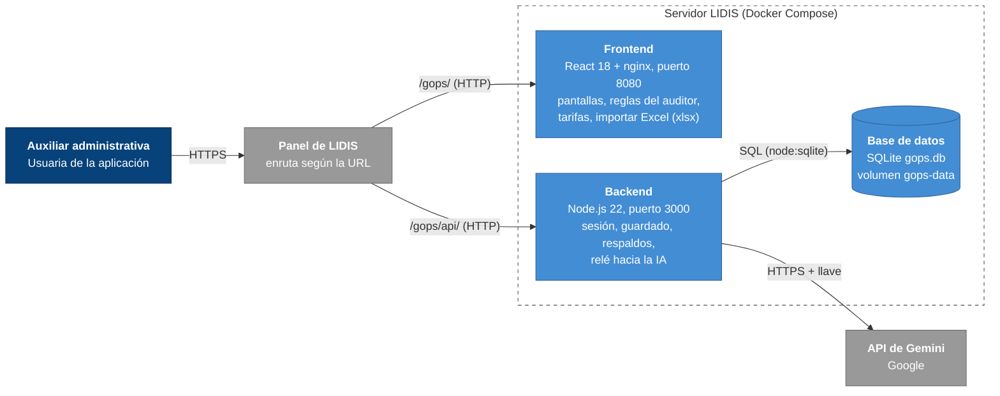
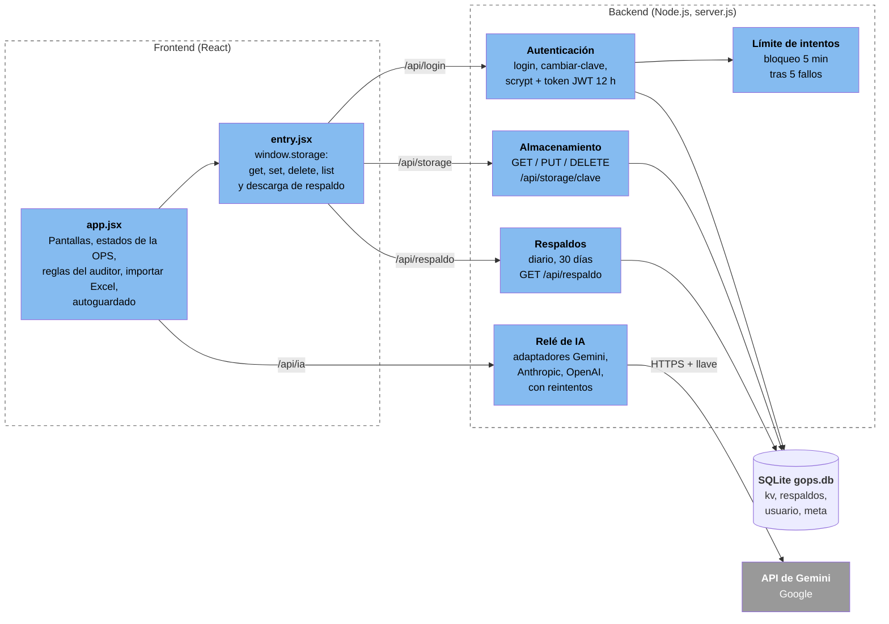
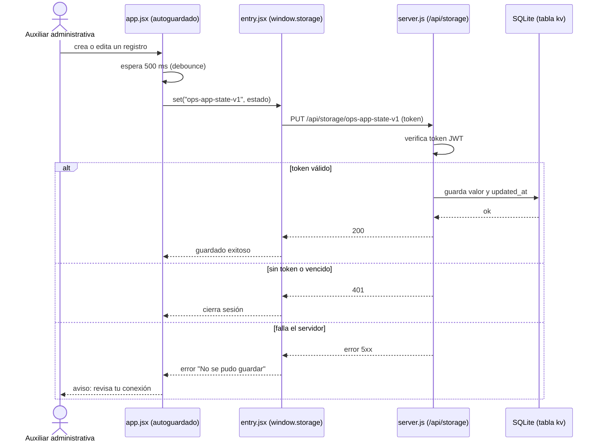

# Diagramas de arquitectura de GOPS

Modelo C4 en Mermaid. GitHub los dibuja automáticamente.
Los diagramas se verificaron contra el código (`server.js`, `app.jsx`, `entry.jsx`, `nginx.conf` y `docker-compose.yml`).

## Nivel 1: Contexto

## Nivel 2: Contenedores

## Nivel 3: Componentes

## Nivel 4: Código (flujo de guardado)

